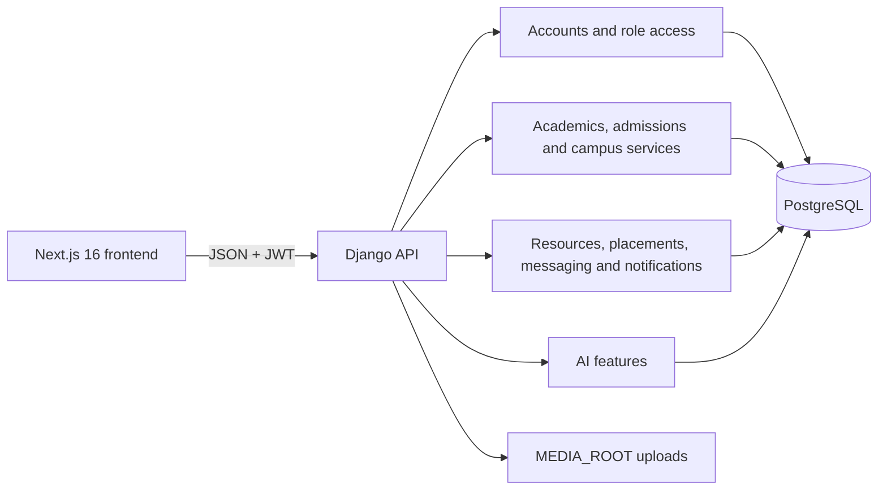

# CampusHub 🎓

A full-stack university student portal built as a capstone project at **The Nairobi National Polytechnic** (Diploma in Computer Science, Level 6).

> Internship project at **Spin Mobile LLC**, Nairobi — October 2026

---

## What is CampusHub?

CampusHub is a centralised web portal for university students, lecturers, and placement officers. It handles student authentication, academic records, resource management, industrial attachment (placement) tracking, and notifications — all in one place.

---

## Tech Stack

| Layer | Technology |
|-------|-----------|
| Backend | Django 6.1 (Plain Django + PyJWT, no DRF) |
| Database | PostgreSQL 18 |
| Frontend | Next.js 16 + TypeScript + Tailwind CSS |
| Architecture | Vertical Slice Architecture (VSA) |
| Deployment | Render (Backend) + Vercel (Frontend) |

## Architecture



The backend is organized into 11 product apps: `accounts`, `academics`, `admissions`, `finance`, `hostels`, `library`, `resources`, `placements`, `messaging`, `notifications`, and `ai`. `common` contains shared request validation, JSON parsing, pagination, and API error helpers. Business workflows include `ApplicationService` for placement applications and `NotificationService` for notifications; the shared `service_api.py` module is a helper layer, not a separate service class. Views use plain Django `JsonResponse` handlers and handwritten serializers; Django REST Framework is not installed.

The frontend has role-aware navigation and permission checks for 11 account roles. These client-side checks improve the UI but do not replace backend authorization. The Examinations page is currently a local-data prototype and does not call a backend endpoint.

---

## API Endpoints

The API is documented in [`campushub-backend/docs/openapi.json`](campushub-backend/docs/openapi.json). JSON endpoints use Django `JsonResponse`; file downloads, CSV exports, and calendar exports use their appropriate content types. Protected routes use JWT auth and structured errors.

| Group | Base Path | Description |
|-------|-----------|-------------|
| Auth | `/api/auth/` | Register, Login (token), Refresh, Me |
| Users | `/api/users/` | Admin user management (CRUD, roles) |
| Lecturers | `/api/lecturers/` | Lecturer directory management |
| Admin | `/api/admin/` | Stats and audit logs |
| Academics | `/api/academics/` | Departments, Courses, Offerings, Assignments & Attachments, Lessons, Attendance |
| Admissions | `/api/admissions/` | Admission application intake and review |
| Finance | `/api/finance/` | Fee structures, invoices, payments and requests |
| Library | `/api/library/` | Books, loans and reservations |
| Hostels | `/api/hostels/` | Hostels, rooms and allocations |
| Resources | `/api/resources/` | File uploads, announcements, downloads |
| Placements | `/api/placements/` | Job listings and applications |
| Notifications | `/api/notifications/` | User notifications, unread counts |
| Messaging | `/api/messaging/` | Direct messages & offering group conversations |
| AI | `/api/ai/` | Chat, insights, task execution and analytics |
| Health | `/api/health/` | Render health check |

---

## Academic Structure

The academics module implements a 4-level hierarchy: **School -> Department -> Unit -> Offering**.

- **Offering** links a Unit to a Course, with teaching assignments, class sessions, assignments, and student groups
- **Assignments** support both `quiz` (auto-marked) and `file` (lecturer-graded) types, optional reference document attachments, authenticated downloads (`GET /assignments/<id>/attachment/`), and full lecturer management (`GET/PATCH/DELETE /assignments/<id>/`)
- **Grade release**: scores hidden from students until `released_at` is set
- **Lessons**: `GET/POST /offerings/<id>/lessons/`, `PATCH/DELETE /lessons/<id>/` with overlap validation
- **Attendance**: `GET/PUT /sessions/<id>/attendance/?date=YYYY-MM-DD` — one row per enrolled student, upsert on PUT
- **Scheduled announcements**: `POST /courses/<id>/announcements/` accepts `scheduled_for` and `group_id`; `python manage.py dispatch_scheduled_announcements` dispatches due announcements
- **Dashboards**: `GET /dashboard/student/` and `GET /dashboard/lecturer/`
- **CSV exports**: `GET /offerings/<id>/grades.csv` and `GET /offerings/<id>/roster.csv`

---

## User Roles

| Role | Description |
|------|-------------|
| `student` | Access own records, resources, enroll, apply for placements |
| `lecturer` | Upload resources, post announcements, view course rosters |
| `officer` | Manage placement listings and review applications |
| `admin` | Super Admin account and system administration |
| `ict_admin` | Academic and IT administration |
| `registrar` | Academic periods, registrations, admissions and student onboarding |
| `finance` | Fees, invoices, payments and payment requests |
| `hod` | Department-level academic oversight |
| `examination` | Academic results and examination workflows |
| `librarian` | Library catalogue and circulation |
| `hostel` | Hostel inventory and student allocations |

---

## Local Development Setup

### Prerequisites
- Python 3.14+
- Node.js 22+
- PostgreSQL 18

### Backend

```bash
# 1. Clone the repo
git clone https://github.com/N3stah/CampusHub-Monorepo.git
cd CampusHub-Monorepo/campushub-backend

# 2. Create and activate virtual environment
python3 -m venv venv
source venv/bin/activate

# 3. Install dependencies
pip install -r requirements.txt

# 4. Create .env file (copy from .env.example and fill in values)
cp .env.example .env

# 5. Create PostgreSQL database
sudo -u postgres psql -c "CREATE DATABASE campushub_db;"
sudo -u postgres psql -c "CREATE USER campushub_user WITH PASSWORD 'your_password';"
sudo -u postgres psql -c "GRANT ALL PRIVILEGES ON DATABASE campushub_db TO campushub_user;"
sudo -u postgres psql -d campushub_db -c "GRANT ALL ON SCHEMA public TO campushub_user;"

# 6. Run migrations
python manage.py migrate

# 7. (Optional) Seed demo data
python manage.py seed_data

# 8. Start development server
python manage.py runserver
```

> **Note:** On Ubuntu 26.04, PostgreSQL 18 listens on port **5434** by default, not 5432. Set `DB_PORT=5434` in your `.env`.

### Frontend

```bash
cd ../campushub-frontend
npm install
npm run dev
```

---

## Management Commands

- `python manage.py seed_data`: Populates the DB with demo users (Admin, Officer, Lecturers, Students), departments, courses, and placements. Safe to run multiple times.
- `python manage.py import_students path.csv`: Imports students from a CSV file with row-level validation.
- `python manage.py cleanup_notifications --days 30`: Deletes read notifications older than N days.

---

## Deployment

### Backend (Render)
1. Create a Web Service pointing to the `campushub-backend/` directory.
2. Set the environment variables required by `config/settings/prod.py`, plus:
   - `RESEND_API_KEY`: API key from Resend.
   - `DEFAULT_FROM_EMAIL`: sender address on a domain verified with Resend, for example `CampusHub <no-reply@your-domain.com>`.
3. Verify the sender domain and its DNS records in Resend before sending. Keep the API key only in the Render backend's environment settings; do not put it in the frontend or commit it.
   Remove any old `EMAIL_BACKEND`, `EMAIL_HOST_*`, or SMTP settings from Render; the application now always uses Resend.
4. Render will automatically run `pip install`, `collectstatic`, and `migrate` on deploy.
5. Do NOT run `seed_data` in production with default passwords. It will refuse to run unless `DEBUG=False` is bypassed with `--force` and `SEED_*_PASSWORD` environment variables are set.

> **Security Note:** `seed_data` includes a production guard. It will refuse to run if `DEBUG=False` unless passed `--force`. If forced, it reads passwords from `SEED_*_PASSWORD` environment variables instead of hard-coded defaults. Demo accounts are for local/dev use only.

### Frontend (Vercel)
1. Import the repository to Vercel.
2. Set the Root Directory to `campushub-frontend`.
3. Set the `NEXT_PUBLIC_API_URL` environment variable to your live Render backend URL.
4. Deploy.

### Live deployment

- Backend: [campushub-backend-nbgc.onrender.com](https://campushub-backend-nbgc.onrender.com)
- Frontend: [campus-hub-monorepo.vercel.app](https://campus-hub-monorepo.vercel.app)

---

## Documentation

- [`docs/ERD.md`](docs/ERD.md): Current schema, normalization write-up, and raw SQL queries.
- [`docs/PHASE_STATUS.md`](docs/PHASE_STATUS.md): Detailed phase tracker and blocker log.
- [`campushub-backend/docs/openapi.json`](campushub-backend/docs/openapi.json): OpenAPI 3 endpoint reference.
- [`campushub-backend/docs/CampusHub_Auth.postman_collection.json`](campushub-backend/docs/CampusHub_Auth.postman_collection.json): Authentication request collection.
- [`REFLECTION.md`](REFLECTION.md): Capstone reflection.

---

## Team

| Role | Name | GitHub |
|------|------|--------|
| Backend Developer | Mark Manoti | [@N3stah](https://github.com/N3stah) |
| Frontend Developer | Titus | [@koech](https://github.com/Koech028) |

---

## License

Academic project — The Nairobi National Polytechnic / Spin Mobile LLC internship, 2026.
