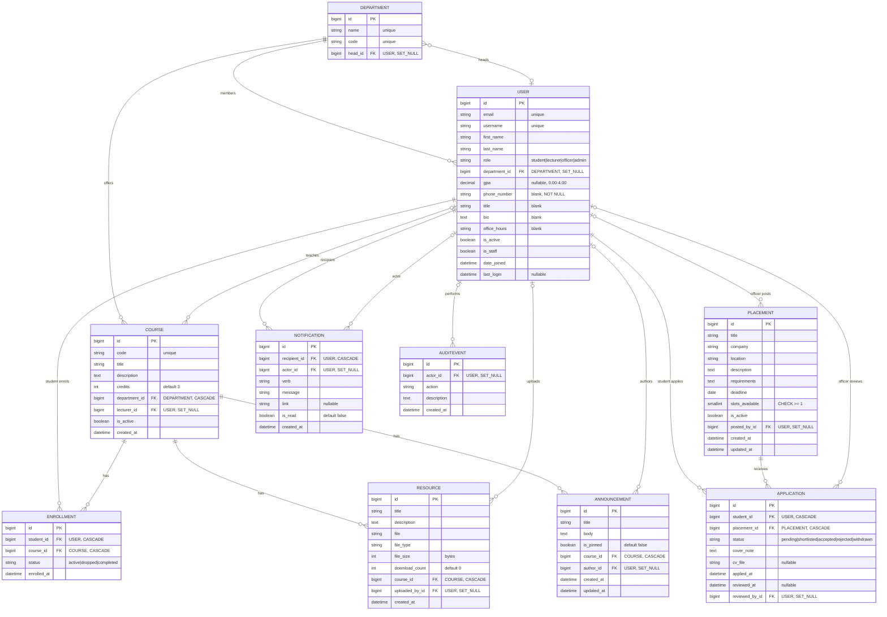
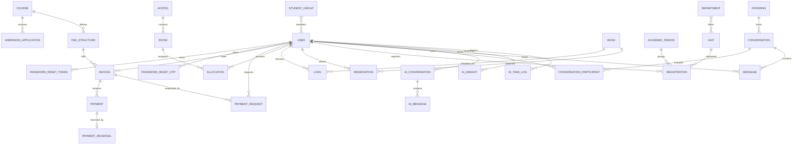

# CampusHub — Database Design Document

**Project:** CampusHub — University Departmental Resource & Placement Portal
**Stack:** Plain Django (no DRF) + PyJWT · PostgreSQL 18 · Next.js (App Router)
**Internship:** Spin Mobile LLC — 12-Week Roadmap (Aug 17 – Nov 6, 2026)
**ERD Version:** v5.0 · **Date:** 2026-11-11
**Authors:** Mark Manoti (N3stah) · Titus

> This document matches the models on `main`. Table names are the real Django table names
> (e.g. `accounts_user`, not `users_user`). The four SQL queries in section 6 live in
> `campushub-backend/docs/sql/` and were executed against a seeded database.

## Table of Contents

1. [Entity Overview](#1-entity-overview)
2. [ERD Diagram (Mermaid)](#2-erd-diagram-mermaid)
3. [Table Definitions](#3-table-definitions)
4. [Relationship Summary](#4-relationship-summary)
5. [Normalization Write-up (1NF → 3NF)](#5-normalization-write-up)
6. [Raw SQL Queries](#6-raw-sql-queries)
7. [Design Decisions](#7-design-decisions)
8. [Known Limitations](#8-known-limitations)
9. [v5.0 Additions and Full-Schema Normalization](#9-v50-additions-and-full-schema-normalization)

---

## 1. Entity Overview

| # | Table | Purpose | Key Relationships |
|---|-------|---------|-------------------|
| 1 | `accounts_user` | Custom Django user (11 roles) | Central node, links to everything |
| 2 | `academics_department` | Academic departments (CS, EE, …) | 1:N to Course, 1:N to User |
| 3 | `academics_course` | Courses offered per department | 1:N from Department, N:M to User via Enrollment |
| 4 | `academics_enrollment` | N:M bridge: Student ↔ Course | FK to User + Course |
| 5 | `resources_resource` | Uploaded files per course | FK to Course + uploader User |
| 6 | `resources_announcement` | Announcements pinned to courses | FK to Course + author User |
| 7 | `placements_placement` | Internship/job listings | FK to posting officer User |
| 8 | `placements_application` | Student submissions to placements | FK to Student User + Placement |
| 9 | `notifications_notification` | In-app notifications | FK to recipient User + actor User |
| 10 | `accounts_auditevent` | Admin activity history | FK to actor User (nullable) |
| 11 | `academics_school` | Top-level academic unit | 1:N to Department, 1:N to Unit |
| 12 | `academics_unit` | Academic unit within a School | 1:N to Offering |
| 13 | `academics_offering` | Links Unit to Course | 1:N to ClassSession, Assignment, Lesson |
| 14 | `academics_unitteachingassignment` | Lecturer assigned to Offering | FK to Offering + User |
| 15 | `academics_classsession` | Recurring weekly class slot | FK to Offering, 1:N AttendanceRecord |
| 16 | `academics_assignment` | Assignment (quiz/file) | 1:N Question, 1:N Submission |
| 17 | `academics_assignmentquestion` | Quiz question | FK to Assignment |
| 18 | `academics_assignmentsubmission` | Student submission | FK to Assignment + Student, released_at |
| 19 | `academics_groupset` | OneToOne with Offering | 1:N StudentGroup |
| 20 | `academics_studentgroup` | Group within GroupSet | M2M members to User |
| 21 | `academics_lesson` | Scheduled lesson | FK to Offering |
| 22 | `academics_attendancerecord` | Per-student attendance | FK to ClassSession + Student |

**v3 baseline:** 22 model tables. The current schema contains 45 concrete CampusHub model tables plus two implicit many-to-many link tables (47 CampusHub tables total), excluding Django framework tables.
**Relationship types exercised:** 1:N (Department → Course), N:M (Student ↔ Course via Enrollment), and a role discriminator on User.

---

## 2. ERD Diagram (Mermaid)

Renders on GitHub, in VS Code (Mermaid extension) and at mermaid.live.



---

## 3. Table Definitions

### 3.1 `accounts_user` — Custom User Model

Extends `AbstractBaseUser` + `PermissionsMixin`. `AUTH_USER_MODEL = 'accounts.User'`, `db_table = 'accounts_user'`.

| Column | Django Field | Type | Constraints | Notes |
|--------|--------------|------|-------------|-------|
| id | BigAutoField | BIGINT | PK | |
| email | EmailField | VARCHAR(254) | UNIQUE, NOT NULL | Login identifier (`USERNAME_FIELD`) |
| username | CharField(50) | VARCHAR(50) | UNIQUE, NOT NULL | Display name |
| first_name | CharField(100) | VARCHAR(100) | NOT NULL | |
| last_name | CharField(100) | VARCHAR(100) | NOT NULL | |
| role | CharField(20) | VARCHAR(20) | NOT NULL, choices | student, lecturer, officer, admin, ict_admin, registrar, finance, hod, examination, librarian, hostel |
| department_id | ForeignKey(Department) | BIGINT | FK, NULL, SET_NULL | NULL for admins/officers with no department |
| gpa | DecimalField(3,2) | NUMERIC(3,2) | NULL | Students only, 0.00–4.00. Admin-editable only |
| phone_number | CharField(20) | VARCHAR(20) | NOT NULL, blank allowed | Empty string when not provided |
| title | CharField(100) | VARCHAR(100) | blank allowed | Lecturer title |
| bio | TextField | TEXT | blank allowed | Lecturer biography |
| office_hours | CharField(200) | VARCHAR(200) | blank allowed | Lecturer contact hours |
| is_active | BooleanField | BOOLEAN | DEFAULT TRUE | Controls login access |
| must_change_password | BooleanField | BOOLEAN | DEFAULT FALSE | Blocks protected routes until initial password change |
| initial_password_expires_at | DateTimeField | TIMESTAMPTZ | NULL | Temporary initial password expiry |
| invitation_email_status | CharField(16) | VARCHAR(16) | DEFAULT `not_sent` | `not_sent`, `sent`, or `failed` |
| is_staff | BooleanField | BOOLEAN | DEFAULT FALSE | Django admin access |
| date_joined | DateTimeField | TIMESTAMPTZ | auto_now_add | |
| last_login | DateTimeField | TIMESTAMPTZ | NULL | Maintained by Django auth |

Constraints:

```sql
UNIQUE (email)
UNIQUE (username)
CHECK (gpa >= 0.00 AND gpa <= 4.00 OR gpa IS NULL)               -- user_gpa_range
CHECK (role IN ('student', 'lecturer', 'officer', 'admin', 'ict_admin', 'registrar', 'finance', 'hod', 'examination', 'librarian', 'hostel')) -- user_valid_role
```

### 3.2 `academics_department`

| Column | Django Field | Type | Constraints | Notes |
|--------|--------------|------|-------------|-------|
| id | BigAutoField | BIGINT | PK | |
| name | CharField(150) | VARCHAR(150) | UNIQUE, NOT NULL | Full name |
| code | CharField(10) | VARCHAR(10) | UNIQUE, NOT NULL | Short code, e.g. CS |
| head_id | ForeignKey(User) | BIGINT | FK, NULL, SET_NULL | Head of department (must be a lecturer, enforced in the view) |

### 3.3 `academics_course`

| Column | Django Field | Type | Constraints | Notes |
|--------|--------------|------|-------------|-------|
| id | BigAutoField | BIGINT | PK | |
| code | CharField(20) | VARCHAR(20) | UNIQUE, NOT NULL | e.g. CS301 |
| title | CharField(200) | VARCHAR(200) | NOT NULL | |
| description | TextField | TEXT | blank allowed | |
| credits | IntegerField | INTEGER | DEFAULT 3 | |
| department_id | ForeignKey(Department) | BIGINT | FK, CASCADE | Required |
| lecturer_id | ForeignKey(User) | BIGINT | FK, NULL, SET_NULL | Unassigned when NULL |
| is_active | BooleanField | BOOLEAN | DEFAULT TRUE | Soft delete flag |
| created_at | DateTimeField | TIMESTAMPTZ | auto_now_add | |

### 3.4 `academics_enrollment` — N:M bridge

| Column | Django Field | Type | Constraints | Notes |
|--------|--------------|------|-------------|-------|
| id | BigAutoField | BIGINT | PK | |
| student_id | ForeignKey(User) | BIGINT | FK, CASCADE | Must have role=student (enforced in the view) |
| course_id | ForeignKey(Course) | BIGINT | FK, CASCADE | |
| enrolled_at | DateTimeField | TIMESTAMPTZ | auto_now_add | |
| status | CharField(20) | VARCHAR(20) | DEFAULT 'active' | active, dropped, completed |

```sql
UNIQUE (student_id, course_id)   -- prevents duplicate enrolment
INDEX  (course_id, status)       -- roster queries
```

### 3.5 `resources_resource`

| Column | Django Field | Type | Constraints | Notes |
|--------|--------------|------|-------------|-------|
| id | BigAutoField | BIGINT | PK | |
| title | CharField(200) | VARCHAR(200) | NOT NULL | |
| description | TextField | TEXT | blank allowed | |
| file | FileField | VARCHAR(100) | NOT NULL | Stored under `media/resources/YYYY/MM/` |
| file_type | CharField(10) | VARCHAR(10) | NOT NULL | pdf, docx, pptx, xlsx, png, jpg |
| file_size | PositiveIntegerField | INTEGER | NOT NULL | Bytes, computed on upload |
| download_count | PositiveIntegerField | INTEGER | DEFAULT 0 | Incremented atomically with `F()` |
| course_id | ForeignKey(Course) | BIGINT | FK, CASCADE | |
| uploaded_by_id | ForeignKey(User) | BIGINT | FK, NULL, SET_NULL | Preserved if the lecturer leaves |
| created_at | DateTimeField | TIMESTAMPTZ | auto_now_add | |

```sql
INDEX (course_id, created_at DESC)   -- list queries
```

### 3.6 `resources_announcement`

| Column | Django Field | Type | Constraints | Notes |
|--------|--------------|------|-------------|-------|
| id | BigAutoField | BIGINT | PK | |
| title | CharField(200) | VARCHAR(200) | NOT NULL | |
| body | TextField | TEXT | NOT NULL | |
| is_pinned | BooleanField | BOOLEAN | DEFAULT FALSE | Pinned items sort first |
| course_id | ForeignKey(Course) | BIGINT | FK, CASCADE | |
| author_id | ForeignKey(User) | BIGINT | FK, NULL, SET_NULL | |
| created_at | DateTimeField | TIMESTAMPTZ | auto_now_add | |
| updated_at | DateTimeField | TIMESTAMPTZ | auto_now | |

Default ordering: `ORDER BY is_pinned DESC, created_at DESC`.

### 3.7 `placements_placement`

| Column | Django Field | Type | Constraints | Notes |
|--------|--------------|------|-------------|-------|
| id | BigAutoField | BIGINT | PK | |
| title | CharField(200) | VARCHAR(200) | NOT NULL | |
| company | CharField(200) | VARCHAR(200) | NOT NULL | |
| location | CharField(200) | VARCHAR(200) | NOT NULL | City or Remote |
| description | TextField | TEXT | NOT NULL | |
| requirements | TextField | TEXT | NOT NULL | |
| deadline | DateField | DATE | NOT NULL | Validated: must be a future date |
| slots_available | PositiveSmallIntegerField | SMALLINT | DEFAULT 1 | CHECK >= 1 |
| is_active | BooleanField | BOOLEAN | DEFAULT TRUE | |
| posted_by_id | ForeignKey(User) | BIGINT | FK, NULL, SET_NULL | Officer who posted |
| created_at | DateTimeField | TIMESTAMPTZ | auto_now_add | |
| updated_at | DateTimeField | TIMESTAMPTZ | auto_now | |

```sql
CHECK (slots_available >= 1)   -- placement_slots_gte_1
```

### 3.8 `placements_application`

| Column | Django Field | Type | Constraints | Notes |
|--------|--------------|------|-------------|-------|
| id | BigAutoField | BIGINT | PK | |
| student_id | ForeignKey(User) | BIGINT | FK, CASCADE | |
| placement_id | ForeignKey(Placement) | BIGINT | FK, CASCADE | |
| status | CharField(20) | VARCHAR(20) | NOT NULL, choices | pending, shortlisted, accepted, rejected, withdrawn |
| cover_note | TextField | TEXT | NOT NULL | |
| cv_file | FileField | VARCHAR(100) | NULL, blank | Stored under `media/cvs/` |
| applied_at | DateTimeField | TIMESTAMPTZ | auto_now_add | |
| reviewed_at | DateTimeField | TIMESTAMPTZ | NULL | Set when status changes |
| reviewed_by_id | ForeignKey(User) | BIGINT | FK, NULL, SET_NULL | Officer who reviewed |

```sql
UNIQUE (student_id, placement_id)                                                    -- unique_student_placement
CHECK  (status IN ('pending','shortlisted','accepted','rejected','withdrawn'))       -- application_valid_status
INDEX  (placement_id, status)                                                        -- slot counting
INDEX  (student_id, applied_at DESC)                                                 -- student's list
```

### 3.9 `notifications_notification`

| Column | Django Field | Type | Constraints | Notes |
|--------|--------------|------|-------------|-------|
| id | BigAutoField | BIGINT | PK | |
| recipient_id | ForeignKey(User) | BIGINT | FK, CASCADE | |
| actor_id | ForeignKey(User) | BIGINT | FK, NULL, SET_NULL | User who triggered it |
| verb | CharField(50) | VARCHAR(50) | NOT NULL | e.g. `application_status_changed` |
| message | CharField(255) | VARCHAR(255) | NOT NULL | |
| link | CharField(255) | VARCHAR(255) | NULL | Frontend route |
| is_read | BooleanField | BOOLEAN | DEFAULT FALSE | |
| created_at | DateTimeField | TIMESTAMPTZ | auto_now_add | |

```sql
INDEX (recipient_id, is_read, created_at DESC)   -- unread count and list
```

### 3.10 `accounts_auditevent`

| Column | Django Field | Type | Constraints | Notes |
|--------|--------------|------|-------------|-------|
| id | BigAutoField | BIGINT | PK | |
| actor_id | ForeignKey(User) | BIGINT | FK, NULL, SET_NULL | |
| action | CharField(80) | VARCHAR(80) | NOT NULL | e.g. `user.created` |
| description | TextField | TEXT | NOT NULL | |
| created_at | DateTimeField | TIMESTAMPTZ | auto_now_add | |

---


### 3.11 `academics_school`

| Column | Type | Constraints |
|--------|------|-------------|
| id | bigint | PK |
| name | varchar(100) | UNIQUE, NOT NULL |
| code | varchar(20) | UNIQUE, NOT NULL |
| created_at | timestamptz | auto_now_add |
| updated_at | timestamptz | auto_now |

**Relationships:** 1:N to Department, 1:N to Unit.

---

### 3.12 `academics_unit`

| id | bigint | PK |
| school_id | bigint | FK -> school |
| code | varchar(20) | UNIQUE |
| title | varchar(200) | NOT NULL |
| description | text | blank |
| created_at | timestamptz | auto_now_add |

---

### 3.13 `academics_offering`

| id | bigint | PK |
| unit_id | bigint | FK -> unit |
| course_id | bigint | FK -> course |
| is_active | boolean | default True |
| created_at | timestamptz | auto_now_add |

---

### 3.14 `academics_unitteachingassignment`

| id | bigint | PK |
| offering_id | bigint | FK -> offering |
| lecturer_id | bigint | FK -> user |
| created_at | timestamptz | auto_now_add |

Unique on (offering, lecturer).

---

### 3.15 `academics_classsession`

| id | bigint | PK |
| offering_id | bigint | FK -> offering |
| day_of_week | smallint | 0=Mon..6=Sun |
| start_time | time | NOT NULL |
| end_time | time | NOT NULL |
| starts_on | date | NOT NULL |
| ends_on | date | NOT NULL |
| location | varchar(100) | nullable |

---

### 3.16 `academics_assignment`

| id | bigint | PK |
| offering_id | bigint | FK -> offering |
| title | varchar(200) | NOT NULL |
| instructions | text | blank |
| assignment_type | varchar(10) | quiz/file |
| allowed_file_types | json | default [] |
| due_at | timestamptz | NOT NULL |
| max_points | integer | NOT NULL |
| is_published | boolean | default False |
| created_at | timestamptz | auto_now_add |

---

### 3.17 `academics_assignmentquestion`

| id | bigint | PK |
| assignment_id | bigint | FK -> assignment |
| prompt | text | NOT NULL |
| options | json | list of strings |
| correct_option | integer | index, NOT NULL |

`correct_option` never serialized to students.

---

### 3.18 `academics_assignmentsubmission`

| id | bigint | PK |
| assignment_id | bigint | FK -> assignment |
| student_id | bigint | FK -> user |
| answers | json | {question_id: option} |
| file | varchar | nullable |
| score | numeric(5,2) | nullable |
| feedback | text | blank |
| submitted_at | timestamptz | auto_now_add |
| graded_at | timestamptz | nullable |
| released_at | timestamptz | nullable (score hidden until set) |

Unique on (assignment, student).

---

### 3.19 `academics_groupset`

| id | bigint | PK |
| offering_id | bigint | FK -> offering (OneToOne) |
| naming_scheme | varchar(10) | letters/numbers |
| students_per_group | integer | NOT NULL |

---

### 3.20 `academics_studentgroup`

| id | bigint | PK |
| group_set_id | bigint | FK -> groupset |
| name | varchar(10) | NOT NULL |

M2M `members` to accounts_user. Signal enforces one group per student per GroupSet.

---

### 3.21 `academics_lesson`

| id | bigint | PK |
| offering_id | bigint | FK -> offering |
| title | varchar(200) | NOT NULL |
| description | text | blank |
| scheduled_at | timestamptz | NOT NULL |
| duration_minutes | integer | NOT NULL |
| created_at | timestamptz | auto_now_add |

Overlap validation rejects conflicts with other Lessons or ClassSessions.

---

### 3.22 `academics_attendancerecord`

| id | bigint | PK |
| session_id | bigint | FK -> classsession |
| student_id | bigint | FK -> user |
| date | date | NOT NULL |
| status | varchar(10) | present/late/absent/excused |
| note | text | blank |
| recorded_at | timestamptz | auto_now |
| recorded_by_id | bigint | FK -> user, nullable |

Unique on (session, student, date).

---

### 3.23 `resources_announcement` (updated v3.0)

New fields: `scheduled_for` (timestamptz, nullable), `dispatched_at` (timestamptz, nullable), `group_id` (FK -> studentgroup, nullable).

## 4. Relationship Summary

| Relationship | Type | From | To | On Delete |
|--------------|------|------|----|-----------|
| Department → User (head) | 1:0..1 | `Department.head_id` | User | SET_NULL |
| User → Department (member) | N:1 | `User.department_id` | Department | SET_NULL |
| Department → Course | 1:N | `Course.department_id` | Department | CASCADE |
| User (lecturer) → Course | 1:N | `Course.lecturer_id` | User | SET_NULL |
| User (student) → Enrollment | 1:N | `Enrollment.student_id` | User | CASCADE |
| Course → Enrollment | 1:N | `Enrollment.course_id` | Course | CASCADE |
| Course → Resource | 1:N | `Resource.course_id` | Course | CASCADE |
| User → Resource (uploader) | 1:N | `Resource.uploaded_by_id` | User | SET_NULL |
| Course → Announcement | 1:N | `Announcement.course_id` | Course | CASCADE |
| User → Announcement (author) | 1:N | `Announcement.author_id` | User | SET_NULL |
| User (officer) → Placement | 1:N | `Placement.posted_by_id` | User | SET_NULL |
| User (student) → Application | 1:N | `Application.student_id` | User | CASCADE |
| Placement → Application | 1:N | `Application.placement_id` | Placement | CASCADE |
| User (officer) → Application (reviewer) | 1:N | `Application.reviewed_by_id` | User | SET_NULL |
| User (recipient) → Notification | 1:N | `Notification.recipient_id` | User | CASCADE |
| User (actor) → Notification | 1:N | `Notification.actor_id` | User | SET_NULL |
| User (actor) → AuditEvent | 1:N | `AuditEvent.actor_id` | User | SET_NULL |

**Why SET_NULL instead of CASCADE for User FKs on resources, announcements and placements?**
If a lecturer account is deleted, the course content must survive. It belongs to the course, not the person. SET_NULL keeps the data and marks the author as unknown. Cascade deletes on Enrollment, Application and Notification (recipient) are intentional: those rows are meaningless without the student.

**Why CASCADE from Department to Course?** The department is a required parent of a course. In practice the API refuses to delete a department that still has courses, so the cascade is a safety net rather than a normal path.

---

## 5. Normalization Write-up

### 5.1 First Normal Form (1NF)

Every column holds an atomic value and there are no repeating groups.

- `User.role` stores one choice, not a list of roles.
- `Enrollment` bridges the N:M relationship between students and courses instead of storing a list of courses on User.
- `Placement.requirements` is one text block. Filterable skill tags would need a `Skill` table and a bridge table, which is an optional stretch goal.

**Status:** the relational columns of the current schema are in 1NF. The `allowed_file_types` list on Assignment and the JSON payload on AIInsight are intentional semi-structured fields; see §9 for their limitations.

### 5.2 Second Normal Form (2NF)

Every concrete model table uses a surrogate primary key (`id`), so no non-key attribute can depend on only part of a composite primary key. Business uniqueness is enforced separately with unique constraints, including active student Enrollment and student/period/Unit Registration.

**Status:** all 45 concrete CampusHub model tables are in 2NF. The two implicit many-to-many link tables use their complete FK pair as the relationship key.

### 5.3 Third Normal Form (3NF)

No non-key column depends on another non-key column.

- **Course and Department:** a course stores only `department_id`. Anything about the department (its name, its head) is reached by a join, so nothing about the department is repeated on Course.
- **Placement Application:** review state is attached to the application, not duplicated on Placement or User.
- **Finance, Library and Hostel records:** each stores foreign keys to the authoritative student, book, invoice, room, or parent record rather than copying its descriptive attributes.
- **User.gpa:** GPA describes the student and does not depend on `department_id` or `role`. A `StudentProfile` table would avoid NULLs for non-students. We kept GPA on User for simplicity, which is a documented design choice (see section 7).

**Status:** the relational columns in the current schema satisfy 3NF, with acknowledged design choices for `gpa` on User and semi-structured JSON/list fields noted in §9.

### 5.4 Anomaly elimination

| Anomaly | Example without normalization | How the schema prevents it |
|---------|-------------------------------|----------------------------|
| Insert | Cannot record a department until a course exists | Department is its own table |
| Update | Renaming a department means editing every Course row | The name lives in one Department row |
| Delete | Deleting the last student of a course loses the course | Course is independent of Enrollment |
| Duplicate data | Storing the lecturer's name on every Resource | The name lives once on User; Resource stores an FK |

---

## 6. Raw SQL Queries

Location in the repository: `campushub-backend/docs/sql/`. These satisfy the capstone brief's "3+ table JOIN" requirement. All four were executed against a seeded database and run without errors. Query 3 returns no rows until at least one resource has been uploaded.

### Query 1 — Students with enrolled courses and resource counts

`docs/sql/01_student_course_resources.sql` · joins 5 tables: enrollment, user, course, department, resource.

```sql
-- Purpose: For each student, list their enrolled courses and how many
--          resources each course has. Used on the student dashboard.

SELECT
    u.id                                AS student_id,
    u.first_name || ' ' || u.last_name  AS student_name,
    u.email,
    d.name                              AS department_name,
    c.id                                AS course_id,
    c.code                              AS course_code,
    c.title                             AS course_title,
    COUNT(r.id)                         AS resource_count
FROM academics_enrollment e
    INNER JOIN accounts_user      u ON u.id = e.student_id
    INNER JOIN academics_course   c ON c.id = e.course_id
    LEFT  JOIN academics_department d ON d.id = c.department_id
    LEFT  JOIN resources_resource   r ON r.course_id = c.id
WHERE u.role = 'student'
  AND u.is_active = TRUE
GROUP BY
    u.id, u.first_name, u.last_name, u.email,
    d.name,
    c.id, c.code, c.title
ORDER BY u.last_name, c.code;
```

### Query 2 — Placements with application counts and average applicant GPA

`docs/sql/02_placements_with_stats.sql` · joins 4 table references: placement, application, user (students) and user (officers, second alias).

```sql
-- Purpose: Placement officer dashboard — show each active placement
--          with application counts and average applicant GPA.

SELECT
    p.id                            AS placement_id,
    p.title                         AS placement_title,
    p.company,
    p.deadline,
    p.slots_available,
    u_officer.first_name || ' ' || u_officer.last_name AS posted_by,
    COUNT(a.id)                     AS total_applications,
    ROUND(AVG(u_student.gpa), 2)    AS avg_applicant_gpa
FROM placements_placement p
    LEFT JOIN placements_application a  ON a.placement_id = p.id
    LEFT JOIN accounts_user u_student   ON u_student.id = a.student_id
    LEFT JOIN accounts_user u_officer   ON u_officer.id = p.posted_by_id
WHERE p.is_active = TRUE
GROUP BY
    p.id, p.title, p.company, p.deadline, p.slots_available,
    u_officer.first_name, u_officer.last_name
ORDER BY total_applications DESC, p.deadline ASC;
```

### Query 3 — Lecturers ranked by resource uploads per department

`docs/sql/03_lecturer_upload_leaderboard.sql` · joins 3 tables: user, department, resource.

```sql
-- Purpose: Admin view — rank lecturers within each department by how many
--          resources they have uploaded.

SELECT
    d.name                              AS department_name,
    d.code                              AS department_code,
    u.id                                AS lecturer_id,
    u.first_name || ' ' || u.last_name  AS lecturer_name,
    u.email,
    COUNT(r.id)                         AS total_uploads,
    SUM(r.file_size)                    AS total_bytes_uploaded,
    SUM(r.download_count)               AS total_downloads
FROM accounts_user u
    INNER JOIN academics_department d ON d.id = u.department_id
    LEFT  JOIN resources_resource   r ON r.uploaded_by_id = u.id
WHERE u.role = 'lecturer'
  AND u.is_active = TRUE
GROUP BY
    d.id, d.name, d.code,
    u.id, u.first_name, u.last_name, u.email
ORDER BY d.name, total_uploads DESC;
```

### Query 4 — Per-course engagement report

`docs/sql/04_course_engagement_report.sql` · joins 5 table references: course, department, user (lecturer), enrollment, resource.

```sql
-- Purpose: Department head dashboard — per-course snapshot showing
--          lecturer assignment, enrolled students, and resource counts.

SELECT
    d.name                              AS department_name,
    c.code                              AS course_code,
    c.title                             AS course_title,
    c.credits,
    COALESCE(
        u_lec.first_name || ' ' || u_lec.last_name,
        'Unassigned'
    )                                   AS lecturer_name,
    COUNT(DISTINCT e.student_id)        AS enrolled_students,
    COUNT(DISTINCT r.id)                AS resource_count
FROM academics_course c
    INNER JOIN academics_department d       ON d.id = c.department_id
    LEFT  JOIN accounts_user           u_lec ON u_lec.id = c.lecturer_id
    LEFT  JOIN academics_enrollment e       ON e.course_id = c.id
    LEFT  JOIN resources_resource   r       ON r.course_id = c.id
GROUP BY
    d.name, c.id, c.code, c.title, c.credits,
    u_lec.first_name, u_lec.last_name
ORDER BY d.name, enrolled_students DESC;
```

---

## 7. Design Decisions

**Why plain Django + PyJWT instead of Django REST Framework?**
Our mentor asked us to remove DRF to understand the underlying mechanics. Views return `JsonResponse`, input is parsed and validated by hand, and the `@jwt_required` decorator handles authentication. Errors are always `{"error": "..."}`.

**Why BigAutoField instead of UUID for primary keys?**
It is Django's default. UUIDs add storage and debugging cost with no meaningful benefit at this scale. Enumeration of IDs is mitigated by authentication and object-level checks, not by opaque IDs.

**Why SET_NULL on lecturer, author and uploader FKs instead of PROTECT?**
PROTECT would block deleting a user who has any records. SET_NULL keeps the content and drops only the link to the person.

**Why is `gpa` on User rather than a separate StudentProfile?**
Simplicity for this scope, and Query 2 needs GPA in an aggregate across applications, so a separate table would add a join. GPA is limited to 0.00–4.00 by a database CheckConstraint. It is deliberately **not** self-editable through `/api/auth/me/`: it feeds shortlisting, so only an admin can change it.

**Why `IntegerField` for `credits` but `PositiveSmallIntegerField` for `slots_available`?**
`slots_available` is small and bounded, and has a DB-level `>= 1` CheckConstraint. `credits` is a plain `IntegerField(default=3)`.

**Why a UniqueConstraint on Application(student, placement)?**
It stops duplicate applications at the database level, so the database has the final say even if two requests race. `ApplicationService.submit` also runs inside `transaction.atomic` with `select_for_update`.

**Why `is_pinned` on Announcement?**
Pinned items sort first through `Meta.ordering = ['-is_pinned', '-created_at']`.

**Why a `withdrawn` status on Application?**
A student can withdraw a pending application without a hard delete. `withdrawn` does not count against the slot total in `ApplicationService`.

**Why a Notification model and a service?**
To decouple alerts from business logic. `NotificationService.notify()` de-duplicates identical notifications within 5 minutes, and `notify_bulk()` uses `bulk_create`. Both are called from the resource, announcement and placement/application code paths.

**Why an AuditEvent table?**
Every administrative write records who did what, which gives the admin log endpoint something real to read.

---

## 8. Known Limitations

- Uploads are validated by extension and size only, with no MIME sniffing.
- Uploaded files are stored on the local filesystem (`MEDIA_ROOT`). On Render's ephemeral disk they are lost on redeploy until object storage (S3, Cloudinary) is added.
- Rate limiting uses django-ratelimit with the default cache, so limits are per worker process, not global.
- GPA lives on User. A `StudentProfile` table is a possible later refactor.
- There is no `semester` on Enrollment, so a student cannot re-enrol in the same course in a later term.

## 9. v5.0 Additions and Full-Schema Normalization

The v5.0 audit compared the ERD with the Django models on 2026-11-11. The original 22 model tables remain; 23 concrete model tables have since been added. The schema now has 45 concrete CampusHub model tables and two implicit many-to-many link tables. Framework-owned Django tables are not included.

### 9.1 v5.0 entity overview

| # | Table | Purpose and key relationships |
|---|---|---|
| 23 | `academics_academicperiod` | Academic year/period; parent of Registration and Offering |
| 24 | `academics_registration` | Student-to-Unit registration in an AcademicPeriod |
| 25 | `accounts_passwordresettoken` | One-time reset token owned by User |
| 26 | `accounts_passwordresetotp` | Hashed, expiring one-time recovery code owned by User |
| 27 | `admissions_application` | Applicant admission request for an academics Course |
| 28 | `finance_feestructure` | Programme/year fee definition |
| 29 | `finance_invoice` | Student invoice for a FeeStructure |
| 30 | `finance_payment` | Payment record against an Invoice |
| 31 | `finance_paymentreversal` | Audited one-to-one reversal of Payment |
| 32 | `finance_paymentrequest` | Student payment request against Invoice |
| 33 | `hostels_hostel` | Hostel inventory and capacity |
| 34 | `hostels_room` | Room within a Hostel |
| 35 | `hostels_allocation` | Student allocation/request for a Room |
| 36 | `library_book` | Library catalogue item |
| 37 | `library_loan` | Student loan of a Book |
| 38 | `library_reservation` | Student reservation of a Book |
| 39 | `messaging_conversation` | Direct or Offering-linked group conversation |
| 40 | `messaging_conversationparticipant` | User membership and read state in a Conversation |
| 41 | `messaging_message` | Message and sender within a Conversation |
| 42 | `ai_conversation` | User-owned AI chat and role context |
| 43 | `ai_message` | User/assistant message within an AIConversation |
| 44 | `ai_insight` | User-owned generated insight |
| 45 | `ai_task_log` | AI task execution summary, optionally linked to User |

`academics_unit_departments` and `academics_studentgroup_members` are implicit many-to-many join tables for `Unit.departments` and `StudentGroup.members`.

### 9.2 v5.0 relationship additions (Mermaid)



### 9.3 v5.0 table definitions

| Table | Columns and relationships |
|---|---|
| `academics_academicperiod` | `name`, `academic_year`, `start_date`, `end_date`, `status`, `is_current`, `created_at`; partial unique constraint permits one current period. |
| `academics_registration` | FKs `student_id`, `academic_period_id`, `unit_id`; `status`, `registered_on`, timestamps; unique student/period/Unit. |
| `accounts_passwordresettoken` | FK `user_id`; unique UUID `token`, `created_at`, nullable `used_at`, `expires_at`. |
| `accounts_passwordresetotp` | FK `user_id`; `code_hash`, `created_at`, `expires_at`, `attempts`, nullable `consumed_at`. |
| `admissions_application` | Applicant name, email and phone; FK `programme_id` to Course; `status`, `notes`, timestamps; unique email/programme. |
| `finance_feestructure` | FK `programme_id` to Course; `name`, `academic_year`, `amount`, optional `due_date`, `status`, `created_at`; unique name/programme/year. |
| `finance_invoice` | FK `student_id` to User and `fee_structure_id`; unique generated `invoice_number`, `amount`, `due_date`, `status`, `description`, timestamps. |
| `finance_payment` | FK `invoice_id`; `amount`, `method`, unique `reference`, `paid_at`, `status`, `created_at`. |
| `finance_paymentreversal` | One-to-one FK `payment_id`, FK `actor_id` to User; `reason`, `created_at`. |
| `finance_paymentrequest` | FKs `invoice_id`, `student_id`; `method`, `phone_number`, `status`, `created_at`. |
| `hostels_hostel` | Unique `name`; `location`, `gender_policy`, `capacity`, `status`, `description`, `created_at`. |
| `hostels_room` | FK `hostel_id`; `room_number`, `capacity`, `status`, `created_at`; unique hostel/room number. |
| `hostels_allocation` | FKs `student_id`, `room_id`; `academic_year`, `starts_on`, optional `ends_on`, `status`, timestamps. |
| `library_book` | Optional unique `isbn`; `title`, `author`, `category`, `total_copies`, `location`, `status`, timestamps. |
| `library_loan` | FKs `book_id`, `student_id`; `borrowed_on`, `due_date`, optional `returned_on`, `status`, `created_at`. |
| `library_reservation` | FKs `book_id`, `student_id`; `reserved_on`, optional `expires_on`, `status`, `created_at`. |
| `messaging_conversation` | `kind`, optional FK `offering_id`, `created_at`. |
| `messaging_conversationparticipant` | FKs `conversation_id`, `user_id`; `is_admin`, `joined_at`, optional `last_read_at`; unique conversation/user. |
| `messaging_message` | FKs `conversation_id`, `sender_id`; `body`, `created_at`, optional `deleted_at`. |
| `ai_conversation` | FK `user_id`; `role_context`, optional `title`, `created_at`, `updated_at`; database table is explicitly `ai_conversation`. |
| `ai_message` | FK `conversation_id`; `role`, `content`, optional `ai_provider`, `created_at`; database table is `ai_message`. |
| `ai_insight` | FK `user_id`; `insight_type`, JSON `content`, `generated_at`, optional `expires_at`; database table is `ai_insight`. |
| `ai_task_log` | Nullable FK `user_id`; `task_type`, input/output summaries, `provider`, `success`, `created_at`; database table is `ai_task_log`. |

The `accounts_user` additions are `must_change_password`, nullable `initial_password_expires_at`, and `invitation_email_status` (`not_sent`, `sent`, `failed`). Its role choices now include `student`, `lecturer`, `officer`, `admin`, `ict_admin`, `registrar`, `finance`, `hod`, `examination`, `librarian`, and `hostel`. `academics_academicperiod` also adds `academic_year` and `status` (`planned`, `active`, `completed`).

### 9.4 Table-by-table 1NF–3NF check

The v3 definitions in §3 cover the original 22 model tables. The following inventory covers every current CampusHub model table; the two generated join tables are included as well. A row is marked 1NF for relational values; the JSON/list exceptions are stated below.

| Table | 1NF | 2NF | 3NF |
|---|---|---|---|
| `accounts_user` | Pass | Pass | Pass; GPA-on-User is a documented nullable-role trade-off |
| `accounts_auditevent` | Pass | Pass | Pass |
| `accounts_passwordresettoken` | Pass | Pass | Pass |
| `accounts_passwordresetotp` | Pass | Pass | Pass |
| `academics_school` | Pass | Pass | Pass |
| `academics_department` | Pass | Pass | Pass |
| `academics_course` | Pass | Pass | Pass |
| `academics_academicperiod` | Pass | Pass | Pass |
| `academics_registration` | Pass | Pass | Pass |
| `academics_unit` | Pass | Pass | Pass |
| `academics_offering` | Pass | Pass | Pass |
| `academics_unitteachingassignment` | Pass | Pass | Pass |
| `academics_enrollment` | Pass | Pass | Pass |
| `academics_classsession` | Pass | Pass | Pass |
| `academics_assignment` | Exception* | Pass | Pass |
| `academics_assignmentquestion` | Pass | Pass | Pass |
| `academics_assignmentsubmission` | Pass | Pass | Pass |
| `academics_groupset` | Pass | Pass | Pass |
| `academics_studentgroup` | Pass | Pass | Pass |
| `academics_lesson` | Pass | Pass | Pass |
| `academics_attendancerecord` | Pass | Pass | Pass |
| `academics_unit_departments` | Pass | Pass | Pass |
| `academics_studentgroup_members` | Pass | Pass | Pass |
| `resources_resource` | Pass | Pass | Pass |
| `resources_announcement` | Pass | Pass | Pass |
| `placements_placement` | Pass | Pass | Pass |
| `placements_application` | Pass | Pass | Pass |
| `notifications_notification` | Pass | Pass | Pass |
| `messaging_conversation` | Pass | Pass | Pass |
| `messaging_conversationparticipant` | Pass | Pass | Pass |
| `messaging_message` | Pass | Pass | Pass |
| `ai_conversation` | Pass | Pass | Pass |
| `ai_message` | Pass | Pass | Pass |
| `ai_insight` | Exception* | Pass | Pass |
| `ai_task_log` | Pass | Pass | Pass |
| `admissions_application` | Pass | Pass | Pass |
| `finance_feestructure` | Pass | Pass | Pass |
| `finance_invoice` | Pass | Pass | Pass |
| `finance_payment` | Pass | Pass | Pass |
| `finance_paymentreversal` | Pass | Pass | Pass |
| `finance_paymentrequest` | Pass | Pass | Pass |
| `hostels_hostel` | Pass | Pass | Pass |
| `hostels_room` | Pass | Pass | Pass |
| `hostels_allocation` | Pass | Pass | Pass |
| `library_book` | Pass | Pass | Pass |
| `library_loan` | Pass | Pass | Pass |
| `library_reservation` | Pass | Pass | Pass |

All concrete tables use a single-column surrogate primary key, so non-key attributes depend on the whole key. Foreign relationships are represented by FKs rather than duplicated descriptive columns, preventing partial and transitive dependencies. The two generated join tables contain only their relationship keys and therefore have no insert, update, or delete anomalies independent of their parent relationship. Admission uniqueness, one-current-period, one-active-enrollment, and payment reversal constraints prevent duplicate or conflicting facts.

**1NF exceptions and anomaly trade-off:** `Assignment.allowed_file_types` stores a list and `AIInsight.content` stores a JSON payload. These are treated as opaque values by the relational API, but their contents are not individually queryable normalized attributes. If file-type entries or insight attributes need independent filtering, constraints, or reporting, move them to child/typed tables. Decomposing normalized relations also prevents insert/update/delete anomalies: parent entities can exist independently of child records, descriptive values live once at their source, and FKs preserve the relationships.