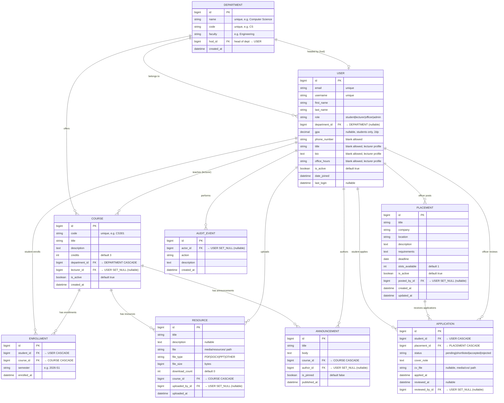

# CampusHub — Database Design Document

> **Project:** CampusHub — University Departmental Resource & Placement Portal  
> **Stack:** Django REST Framework · PostgreSQL · Next.js (App Router)  
> **Internship:** Spin Mobile LLC — 12-Week Roadmap (Aug 17 – Nov 6, 2026)  
> **ERD Version:** v1.0 · **Date:** 2026-10-13  
> **Authors:** Mark Manoti (N3stah) · [Partner Name]

---

## Table of Contents

1. [Entity Overview](#1-entity-overview)
2. [ERD Diagram (Mermaid)](#2-erd-diagram-mermaid)
3. [Table Definitions](#3-table-definitions)
4. [Relationship Summary](#4-relationship-summary)
5. [Normalization Write-up (1NF → 3NF)](#5-normalization-write-up)
6. [Raw SQL Queries](#6-raw-sql-queries)
7. [Design Decisions](#7-design-decisions)

---

## 1. Entity Overview

| # | Table | Purpose | Key Relationships |
|---|-------|---------|-------------------|
| 1 | `accounts_user` | Custom Django user (4 roles) | Central node — links to everything |
| 2 | `academics_department` | Academic departments (CS, EE, …) | 1:N to Course, 1:N to User |
| 3 | `academics_course` | Courses offered per department | 1:N from Dept, N:M to User via Enrollment |
| 4 | `academics_enrollment` | N:M bridge: Student ↔ Course | FK to User + Course |
| 5 | `resources_resource` | Uploaded PDFs/DOCX per course | FK to Course + uploader User |
| 6 | `resources_announcement` | Announcements pinned to courses | FK to Course + author User |
| 7 | `placements_placement` | Internship/job listings | FK to posting officer User |
| 8 | `placements_application` | Student submissions to placements | FK to Student User + Placement |
| 9 | `accounts_auditevent` | Admin activity history | FK to actor User (nullable) |

**Total tables: 9 (minimum requirement met)**
**Relationship types exercised:** 1:N (Dept→Course), N:M (Student↔Course via Enrollment), self-referential role field on User

---

## 2. ERD Diagram (Mermaid)

> Render this in any Mermaid-compatible viewer (GitHub, dbdiagram.io, draw.io, VS Code Mermaid extension).



---

## 3. Table Definitions

### 3.1 `accounts_user` — Custom User Model

> Extends `AbstractBaseUser` + `PermissionsMixin`. Must be declared **before** the first migration via `AUTH_USER_MODEL = 'users.User'` in settings.

| Column | Django Field | Type | Constraints | Notes |
|--------|-------------|------|-------------|-------|
| `id` | `BigAutoField` | BIGINT | PK, auto | Default Django PK |
| `email` | `EmailField` | VARCHAR(254) | UNIQUE, NOT NULL | Primary login identifier |
| `username` | `CharField(50)` | VARCHAR(50) | UNIQUE, NOT NULL | Display name |
| `first_name` | `CharField(100)` | VARCHAR(100) | NOT NULL | |
| `last_name` | `CharField(100)` | VARCHAR(100) | NOT NULL | |
| `role` | `CharField(20)` | VARCHAR(20) | NOT NULL, choices | `student\|lecturer\|officer\|admin` |
| `department_id` | `ForeignKey(Department)` | BIGINT | FK, NULL | NULL for admins/officers with no dept |
| `gpa` | `DecimalField(3,2)` | DECIMAL(3,2) | NULL, blank | Students only; range 0.00–4.00 |
| `phone_number` | `CharField(20)` | VARCHAR(20) | NULL, blank | Optional contact |
| `title` | `CharField(100)` | VARCHAR(100) | blank | Lecturer title |
| `bio` | `TextField` | TEXT | blank | Lecturer biography |
| `office_hours` | `CharField(200)` | VARCHAR(200) | blank | Lecturer contact hours |
| `is_active` | `BooleanField` | BOOLEAN | DEFAULT TRUE | Controls login access |
| `date_joined` | `DateTimeField` | TIMESTAMPTZ | auto_now_add | |
| `last_login` | `DateTimeField` | TIMESTAMPTZ | NULL | Updated by Django auth |

**Constraints:**
```sql
UNIQUE(email)
UNIQUE(username)
CHECK(gpa >= 0.00 AND gpa <= 4.00)
CHECK(role IN ('student', 'lecturer', 'officer', 'admin'))
```

---

### 3.2 `academics_department`

| Column | Django Field | Type | Constraints | Notes |
|--------|-------------|------|-------------|-------|
| `id` | `BigAutoField` | BIGINT | PK | |
| `name` | `CharField(150)` | VARCHAR(150) | UNIQUE, NOT NULL | Full name |
| `code` | `CharField(10)` | VARCHAR(10) | UNIQUE, NOT NULL | Short code e.g. `CS` |
| `faculty` | `CharField(100)` | VARCHAR(100) | NOT NULL | Parent faculty |
| `hod_id` | `ForeignKey(User)` | BIGINT | FK, NULL, SET_NULL | Head of department |
| `created_at` | `DateTimeField` | TIMESTAMPTZ | auto_now_add | |

---

### 3.3 `academics_course`

| Column | Django Field | Type | Constraints | Notes |
|--------|-------------|------|-------------|-------|
| `id` | `BigAutoField` | BIGINT | PK | |
| `code` | `CharField(20)` | VARCHAR(20) | UNIQUE, NOT NULL | e.g. `CS301` |
| `title` | `CharField(200)` | VARCHAR(200) | NOT NULL | |
| `description` | `TextField` | TEXT | blank | |
| `credits` | `PositiveSmallIntegerField` | SMALLINT | DEFAULT 3 | |
| `department_id` | `ForeignKey(Department)` | BIGINT | FK, CASCADE | Dept is required |
| `lecturer_id` | `ForeignKey(User)` | BIGINT | FK, NULL, SET_NULL | Unassigned if NULL |
| `is_active` | `BooleanField` | BOOLEAN | DEFAULT TRUE | |
| `created_at` | `DateTimeField` | TIMESTAMPTZ | auto_now_add | |

---

### 3.4 `academics_enrollment` — N:M Bridge

| Column | Django Field | Type | Constraints | Notes |
|--------|-------------|------|-------------|-------|
| `id` | `BigAutoField` | BIGINT | PK | |
| `student_id` | `ForeignKey(User)` | BIGINT | FK, CASCADE | Must have role=student |
| `course_id` | `ForeignKey(Course)` | BIGINT | FK, CASCADE | |
| `semester` | `CharField(20)` | VARCHAR(20) | NOT NULL | e.g. `2026-S1` |
| `enrolled_at` | `DateTimeField` | TIMESTAMPTZ | auto_now_add | |

**Constraints:**
```sql
UNIQUE(student_id, course_id, semester)  -- prevents duplicate enrollment per semester
```

---

### 3.5 `resources_resource`

| Column | Django Field | Type | Constraints | Notes |
|--------|-------------|------|-------------|-------|
| `id` | `BigAutoField` | BIGINT | PK | |
| `title` | `CharField(200)` | VARCHAR(200) | NOT NULL | |
| `description` | `TextField` | TEXT | blank, null | |
| `file` | `FileField` | VARCHAR(255) | NOT NULL | Stored in `media/resources/` |
| `file_type` | `CharField(10)` | VARCHAR(10) | NOT NULL, choices | `PDF\|DOCX\|PPT\|OTHER` |
| `file_size` | `BigIntegerField` | BIGINT | NOT NULL | Bytes; computed on upload |
| `download_count` | `PositiveIntegerField` | INT | DEFAULT 0 | Incremented on access |
| `course_id` | `ForeignKey(Course)` | BIGINT | FK, CASCADE | |
| `uploaded_by_id` | `ForeignKey(User)` | BIGINT | FK, NULL, SET_NULL | Preserved if lecturer leaves |
| `uploaded_at` | `DateTimeField` | TIMESTAMPTZ | auto_now_add | |

---

### 3.6 `resources_announcement`

| Column | Django Field | Type | Constraints | Notes |
|--------|-------------|------|-------------|-------|
| `id` | `BigAutoField` | BIGINT | PK | |
| `title` | `CharField(200)` | VARCHAR(200) | NOT NULL | |
| `body` | `TextField` | TEXT | NOT NULL | |
| `course_id` | `ForeignKey(Course)` | BIGINT | FK, CASCADE | |
| `author_id` | `ForeignKey(User)` | BIGINT | FK, NULL, SET_NULL | |
| `is_pinned` | `BooleanField` | BOOLEAN | DEFAULT FALSE | Pinned items sort first |
| `published_at` | `DateTimeField` | TIMESTAMPTZ | auto_now_add | |

---

### 3.7 `placements_placement`

| Column | Django Field | Type | Constraints | Notes |
|--------|-------------|------|-------------|-------|
| `id` | `BigAutoField` | BIGINT | PK | |
| `title` | `CharField(200)` | VARCHAR(200) | NOT NULL | Job/internship title |
| `company` | `CharField(150)` | VARCHAR(150) | NOT NULL | |
| `location` | `CharField(150)` | VARCHAR(150) | NOT NULL | City or Remote |
| `description` | `TextField` | TEXT | NOT NULL | |
| `requirements` | `TextField` | TEXT | NOT NULL | |
| `deadline` | `DateField` | DATE | NOT NULL | Validated: must be future |
| `slots_available` | `PositiveSmallIntegerField` | SMALLINT | DEFAULT 1 | |
| `is_active` | `BooleanField` | BOOLEAN | DEFAULT TRUE | |
| `posted_by_id` | `ForeignKey(User)` | BIGINT | FK, NULL, SET_NULL | Officer who posted |
| `created_at` | `DateTimeField` | TIMESTAMPTZ | auto_now_add | |
| `updated_at` | `DateTimeField` | TIMESTAMPTZ | auto_now | |

---

### 3.8 `placements_application`

| Column | Django Field | Type | Constraints | Notes |
|--------|-------------|------|-------------|-------|
| `id` | `BigAutoField` | BIGINT | PK | |
| `student_id` | `ForeignKey(User)` | BIGINT | FK, CASCADE | Must have role=student |
| `placement_id` | `ForeignKey(Placement)` | BIGINT | FK, CASCADE | |
| `status` | `CharField(20)` | VARCHAR(20) | NOT NULL, choices | `pending\|shortlisted\|accepted\|rejected` |
| `cover_note` | `TextField` | TEXT | NOT NULL | Required on submission |
| `cv_file` | `FileField` | VARCHAR(255) | NULL, blank | Stored in `media/cvs/` |
| `applied_at` | `DateTimeField` | TIMESTAMPTZ | auto_now_add | |
| `reviewed_at` | `DateTimeField` | TIMESTAMPTZ | NULL, blank | Set when status changes |
| `reviewed_by_id` | `ForeignKey(User)` | BIGINT | FK, NULL, SET_NULL | Officer who reviewed |

**Constraints:**
```sql
UNIQUE(student_id, placement_id)  -- prevents duplicate application to same placement
CHECK(status IN ('pending', 'shortlisted', 'accepted', 'rejected'))
```

---

### 3.9 `accounts_auditevent`

| Column | Django Field | Type | Constraints | Notes |
|--------|-------------|------|-------------|-------|
| `id` | `BigAutoField` | BIGINT | PK | |
| `actor_id` | `ForeignKey(User)` | BIGINT | FK, NULL, SET_NULL | User who performed the action |
| `action` | `CharField(80)` | VARCHAR(80) | NOT NULL | e.g. `user.created`, `placement.updated` |
| `description` | `TextField` | TEXT | NOT NULL | Human-readable activity summary |
| `created_at` | `DateTimeField` | TIMESTAMPTZ | auto_now_add | |

---

## 4. Relationship Summary

| Relationship | Type | From | To | On Delete |
|-------------|------|------|----|-----------|
| Department → User (HOD) | 1:0..1 | Department.hod_id | User | SET_NULL |
| User → Department | N:1 | User.department_id | Department | SET_NULL |
| Department → Course | 1:N | Course.department_id | Department | CASCADE |
| User (Lecturer) → Course | 1:N | Course.lecturer_id | User | SET_NULL |
| User (Student) → Enrollment | 1:N | Enrollment.student_id | User | CASCADE |
| Course → Enrollment | 1:N | Enrollment.course_id | Course | CASCADE |
| Course → Resource | 1:N | Resource.course_id | Course | CASCADE |
| User → Resource (uploader) | 1:N | Resource.uploaded_by_id | User | SET_NULL |
| Course → Announcement | 1:N | Announcement.course_id | Course | CASCADE |
| User → Announcement (author) | 1:N | Announcement.author_id | User | SET_NULL |
| User (Officer) → Placement | 1:N | Placement.posted_by_id | User | SET_NULL |
| User (Student) → Application | 1:N | Application.student_id | User | CASCADE |
| Placement → Application | 1:N | Application.placement_id | Placement | CASCADE |
| User (Officer) → Application (reviewer) | 1:N | Application.reviewed_by_id | User | SET_NULL |
| User → AuditEvent (actor) | 1:N | AuditEvent.actor_id | User | SET_NULL |

**Why SET_NULL instead of CASCADE for User FK on Resources/Announcements/Placements?**  
If a lecturer account is deleted, their course content (resources, announcements) must survive — those belong to the course, not the person. SET_NULL preserves the data while marking the author as unknown. Student cascade deletes (Enrollment, Application) are intentional: when a student leaves, their participation records are meaningless without the student.

---

## 5. Normalization Write-up

### 5.1 First Normal Form (1NF)
**Rule:** Every column contains atomic (indivisible) values. No repeating groups.

All tables comply:
- `User.role` stores a single string choice, not a comma-separated list of roles.
- `Enrollment` bridges the N:M relationship between students and courses rather than storing a repeating `courses` array on `User`.
- `Placement.requirements` is a single text block. If we needed individual skills as filterable tags, we would add a `Skill` table and a `PlacementSkill` bridge — that is an optional stretch goal.

**Status: ✅ All 9 tables are in 1NF**

---

### 5.2 Second Normal Form (2NF)
**Rule:** In tables with a composite key, every non-key column must depend on the *entire* composite key, not just part of it.

The only table with a meaningful composite uniqueness constraint is `Enrollment(student_id, course_id, semester)`.

| Column | Depends on full composite key? | Verdict |
|--------|-------------------------------|---------|
| `enrolled_at` | Yes — the enrollment *event* requires knowing which student enrolled in which course in which semester | ✅ |

`Enrollment` uses a surrogate PK (`id`) to simplify FK references. No partial dependency violations exist.

**Status: ✅ All 9 tables are in 2NF**

---

### 5.3 Third Normal Form (3NF)
**Rule:** No non-key column should depend on another non-key column (no transitive dependencies).

**Potential violation — `Course` table:**  
`Course.department_id → Course.faculty`? This would be a violation if we stored `faculty` on `Course`. We do not — `faculty` lives only on `Department`. `Course` references `Department` via FK; if you need the faculty name for a course, you join to `Department`. No transitive dependency. ✅

**Potential violation — `Application` table:**  
`Application.reviewed_at` is only meaningful when `status != 'pending'`. This is a business-logic constraint, not a normalization concern. The column does not functionally depend on any non-key attribute. ✅

**Potential violation — `User.gpa`:**  
GPA is a property of the student, not of any other entity. It does not depend on `department_id` or `role`. An argument could be made that GPA belongs in a `StudentProfile` table to avoid NULL columns on non-student users. We chose to keep it on `User` for simplicity at this stage; a `StudentProfile` extension table is documented as a stretch goal.

**Status: ✅ All 9 tables are in 3NF. One acknowledged design choice (gpa on User) documented.**

---

### 5.4 Anomaly Elimination Summary

| Anomaly Type | Example Without Normalization | How Our Schema Prevents It |
|-------------|-------------------------------|---------------------------|
| **Insert anomaly** | Can't record a department until a course exists | Department is its own table; can be created independently |
| **Update anomaly** | Changing a department's name would require updating every Course row | Name lives in one row of `Department`; Course stores FK only |
| **Delete anomaly** | Deleting the last student in a course deletes the course info | Enrollment is the bridge; Course table is independent |
| **Duplicate data** | Storing lecturer name on every Resource | Lecturer name stored once on User; Resource stores FK |

---

## 6. Raw SQL Queries

> Location in repository: `docs/sql/`  
> These queries satisfy the "3+ table JOIN" requirement from the capstone brief.

### Query 1 — Students with enrolled courses and resource counts

```sql
-- docs/sql/01_student_course_resources.sql
-- Purpose: For each student, list their enrolled courses and how many
--          resources each course has. Used on the student dashboard.

SELECT
    u.id                                AS student_id,
    u.first_name || ' ' || u.last_name  AS student_name,
    u.email,
    u.department_id,
    d.name                              AS department_name,
    c.id                                AS course_id,
    c.code                              AS course_code,
    c.title                             AS course_title,
    e.semester,
    COUNT(r.id)                         AS resource_count
FROM academics_enrollment e
    INNER JOIN users_user      u ON u.id = e.student_id
    INNER JOIN academics_course c ON c.id = e.course_id
    LEFT  JOIN academics_department d ON d.id = u.department_id
    LEFT  JOIN resources_resource   r ON r.course_id = c.id
WHERE u.role = 'student'
  AND u.is_active = TRUE
GROUP BY
    u.id, u.first_name, u.last_name, u.email,
    u.department_id, d.name,
    c.id, c.code, c.title, e.semester
ORDER BY u.last_name, c.code;
```

**Tables joined:** `academics_enrollment` ▸ `users_user` ▸ `academics_course` ▸ `academics_department` ▸ `resources_resource` — **5 tables**

---

### Query 2 — Placements with application counts and average applicant GPA

```sql
-- docs/sql/02_placements_with_stats.sql
-- Purpose: For the placement officer dashboard — show each active placement
--          with how many applications it has received and the average GPA
--          of applicants. Helps officers shortlist efficiently.

SELECT
    p.id                            AS placement_id,
    p.title                         AS placement_title,
    p.company,
    p.location,
    p.deadline,
    p.slots_available,
    u_officer.first_name || ' ' || u_officer.last_name AS posted_by,
    COUNT(a.id)                     AS total_applications,
    COUNT(CASE WHEN a.status = 'pending'     THEN 1 END) AS pending_count,
    COUNT(CASE WHEN a.status = 'shortlisted' THEN 1 END) AS shortlisted_count,
    COUNT(CASE WHEN a.status = 'accepted'    THEN 1 END) AS accepted_count,
    ROUND(AVG(u_student.gpa), 2)    AS avg_applicant_gpa
FROM placements_placement p
    LEFT JOIN placements_application a  ON a.placement_id = p.id
    LEFT JOIN users_user u_student      ON u_student.id = a.student_id
    LEFT JOIN users_user u_officer      ON u_officer.id = p.posted_by_id
WHERE p.is_active = TRUE
GROUP BY
    p.id, p.title, p.company, p.location,
    p.deadline, p.slots_available,
    u_officer.first_name, u_officer.last_name
ORDER BY total_applications DESC, p.deadline ASC;
```

**Tables joined:** `placements_placement` ▸ `placements_application` ▸ `users_user` (students) ▸ `users_user` (officers) — **4 tables (users joined twice with aliases)**

---

### Query 3 — Lecturers ranked by total resource uploads per department

```sql
-- docs/sql/03_lecturer_upload_leaderboard.sql
-- Purpose: Admin view — rank lecturers within each department by how many
--          resources they have uploaded. Evidence of active engagement.

SELECT
    d.name                              AS department_name,
    d.code                              AS department_code,
    u.id                                AS lecturer_id,
    u.first_name || ' ' || u.last_name  AS lecturer_name,
    u.email,
    COUNT(r.id)                         AS total_uploads,
    SUM(r.file_size)                    AS total_bytes_uploaded,
    SUM(r.download_count)               AS total_downloads,
    MAX(r.uploaded_at)                  AS last_upload_date
FROM users_user u
    INNER JOIN academics_department d ON d.id = u.department_id
    LEFT  JOIN resources_resource   r ON r.uploaded_by_id = u.id
WHERE u.role = 'lecturer'
  AND u.is_active = TRUE
GROUP BY
    d.id, d.name, d.code,
    u.id, u.first_name, u.last_name, u.email
ORDER BY d.name, total_uploads DESC;
```

**Tables joined:** `users_user` ▸ `academics_department` ▸ `resources_resource` — **3 tables**

---

### Query 4 — Course enrollment report with lecturer and announcement counts

```sql
-- docs/sql/04_course_engagement_report.sql
-- Purpose: Department head dashboard — per-course snapshot showing
--          lecturer assignment, how many students enrolled, and
--          how many announcements have been posted.

SELECT
    d.name                              AS department_name,
    c.code                              AS course_code,
    c.title                             AS course_title,
    c.credits,
    COALESCE(
        u_lec.first_name || ' ' || u_lec.last_name,
        'Unassigned'
    )                                   AS lecturer_name,
    COUNT(DISTINCT e.student_id)        AS enrolled_students,
    COUNT(DISTINCT r.id)                AS resource_count,
    COUNT(DISTINCT ann.id)              AS announcement_count,
    c.is_active
FROM academics_course c
    INNER JOIN academics_department d       ON d.id = c.department_id
    LEFT  JOIN users_user           u_lec   ON u_lec.id = c.lecturer_id
    LEFT  JOIN academics_enrollment e       ON e.course_id = c.id
    LEFT  JOIN resources_resource   r       ON r.course_id = c.id
    LEFT  JOIN resources_announcement ann   ON ann.course_id = c.id
GROUP BY
    d.name, c.id, c.code, c.title, c.credits,
    u_lec.first_name, u_lec.last_name, c.is_active
ORDER BY d.name, enrolled_students DESC;
```

**Tables joined:** `academics_course` ▸ `academics_department` ▸ `users_user` ▸ `academics_enrollment` ▸ `resources_resource` ▸ `resources_announcement` — **6 tables**

---

## 7. Design Decisions

### Why `BigAutoField` instead of `UUID` for PKs?
Django 6's default PK is `BigAutoField` (64-bit integer). UUIDs add complexity (16-byte storage, harder debugging, no natural ordering) without a meaningful benefit at internship scale. If we expose IDs in URLs (e.g., `/api/placements/3/`), that is acceptable; sequential enumeration attacks are mitigated by authentication, not by opaque IDs.

### Why `SET_NULL` on lecturer/author FKs instead of `PROTECT`?
`PROTECT` would prevent deleting a user if they have any associated records — a poor UX and a data management nightmare. `SET_NULL` preserves content ownership history without hard-blocking account deletion. The application layer enforces role-based access, not the database cascade rule.

### Why store `gpa` on `User` rather than a separate `StudentProfile`?
Simplicity for this internship scope. The raw SQL Query 2 requires `gpa` in aggregate queries across applications. A separate table would require one more join. If the system grows to require per-semester GPA tracking, a `StudentProfile` or `AcademicRecord` table is the correct evolution.

### Why `PositiveSmallIntegerField` for `credits` and `slots_available`?
Both values have a natural upper bound (courses rarely exceed 6 credits; slots rarely exceed a few hundred). `SMALLINT` uses 2 bytes vs 4 bytes for `INT`. A `PositiveSmallIntegerField` also adds a Django-level check constraint (`>= 0`), catching invalid data before it reaches the database.

### The `Application` uniqueness constraint
`UNIQUE(student_id, placement_id)` is enforced at both the database level (migration) and the application level (serializer `validate()` method). The database constraint is the safety net; the serializer constraint provides a user-facing error message. Never rely on application code alone for uniqueness — the database is the final arbiter.

---

*Document prepared for Daniel (Spin Mobile internship supervisor) — Week 8 Database Design Deliverable.*
