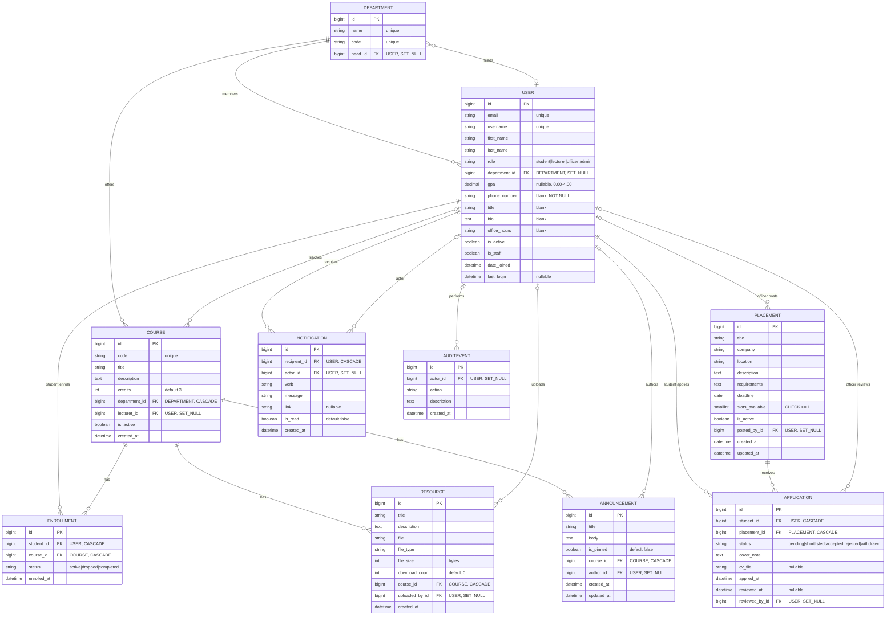

# CampusHub — Database Design Document

**Project:** CampusHub — University Departmental Resource & Placement Portal
**Stack:** Plain Django (no DRF) + PyJWT · PostgreSQL 18 · Next.js (App Router)
**Internship:** Spin Mobile LLC — 12-Week Roadmap (Aug 17 – Nov 6, 2026)
**ERD Version:** v2.1 · **Date:** 2026-10-21
**Authors:** Mark Manoti (N3stah) · Titus

> This document matches the models on `main`. Table names are the real Django table names
> (e.g. `accounts_user`, not `users_user`). The four SQL queries in section 6 live in
> `campushub-backend/docs/sql/` and were executed against a seeded database.

## Table of Contents

1. [Entity Overview](#1-entity-overview)
2. [ERD Diagram (Mermaid)](#2-erd-diagram-mermaid)
3. [Table Definitions](#3-table-definitions)
4. [Relationship Summary](#4-relationship-summary)
5. [Normalization Write-up (1NF → 3NF)](#5-normalization-write-up)
6. [Raw SQL Queries](#6-raw-sql-queries)
7. [Design Decisions](#7-design-decisions)
8. [Known Limitations](#8-known-limitations)

---

## 1. Entity Overview

| # | Table | Purpose | Key Relationships |
|---|-------|---------|-------------------|
| 1 | `accounts_user` | Custom Django user (4 roles) | Central node, links to everything |
| 2 | `academics_department` | Academic departments (CS, EE, …) | 1:N to Course, 1:N to User |
| 3 | `academics_course` | Courses offered per department | 1:N from Department, N:M to User via Enrollment |
| 4 | `academics_enrollment` | N:M bridge: Student ↔ Course | FK to User + Course |
| 5 | `resources_resource` | Uploaded files per course | FK to Course + uploader User |
| 6 | `resources_announcement` | Announcements pinned to courses | FK to Course + author User |
| 7 | `placements_placement` | Internship/job listings | FK to posting officer User |
| 8 | `placements_application` | Student submissions to placements | FK to Student User + Placement |
| 9 | `notifications_notification` | In-app notifications | FK to recipient User + actor User |
| 10 | `accounts_auditevent` | Admin activity history | FK to actor User (nullable) |

**Total tables:** 10 (plus Django's own auth/session/migration tables, not documented here).
**Relationship types exercised:** 1:N (Department → Course), N:M (Student ↔ Course via Enrollment), and a role discriminator on User.

---

## 2. ERD Diagram (Mermaid)

Renders on GitHub, in VS Code (Mermaid extension) and at mermaid.live.



---

## 3. Table Definitions

### 3.1 `accounts_user` — Custom User Model

Extends `AbstractBaseUser` + `PermissionsMixin`. `AUTH_USER_MODEL = 'accounts.User'`, `db_table = 'accounts_user'`.

| Column | Django Field | Type | Constraints | Notes |
|--------|--------------|------|-------------|-------|
| id | BigAutoField | BIGINT | PK | |
| email | EmailField | VARCHAR(254) | UNIQUE, NOT NULL | Login identifier (`USERNAME_FIELD`) |
| username | CharField(50) | VARCHAR(50) | UNIQUE, NOT NULL | Display name |
| first_name | CharField(100) | VARCHAR(100) | NOT NULL | |
| last_name | CharField(100) | VARCHAR(100) | NOT NULL | |
| role | CharField(20) | VARCHAR(20) | NOT NULL, choices | student, lecturer, officer, admin |
| department_id | ForeignKey(Department) | BIGINT | FK, NULL, SET_NULL | NULL for admins/officers with no department |
| gpa | DecimalField(3,2) | NUMERIC(3,2) | NULL | Students only, 0.00–4.00. Admin-editable only |
| phone_number | CharField(20) | VARCHAR(20) | NOT NULL, blank allowed | Empty string when not provided |
| title | CharField(100) | VARCHAR(100) | blank allowed | Lecturer title |
| bio | TextField | TEXT | blank allowed | Lecturer biography |
| office_hours | CharField(200) | VARCHAR(200) | blank allowed | Lecturer contact hours |
| is_active | BooleanField | BOOLEAN | DEFAULT TRUE | Controls login access |
| is_staff | BooleanField | BOOLEAN | DEFAULT FALSE | Django admin access |
| date_joined | DateTimeField | TIMESTAMPTZ | auto_now_add | |
| last_login | DateTimeField | TIMESTAMPTZ | NULL | Maintained by Django auth |

Constraints:

```sql
UNIQUE (email)
UNIQUE (username)
CHECK (gpa >= 0.00 AND gpa <= 4.00 OR gpa IS NULL)               -- user_gpa_range
CHECK (role IN ('student', 'lecturer', 'officer', 'admin'))      -- user_valid_role
```

### 3.2 `academics_department`

| Column | Django Field | Type | Constraints | Notes |
|--------|--------------|------|-------------|-------|
| id | BigAutoField | BIGINT | PK | |
| name | CharField(150) | VARCHAR(150) | UNIQUE, NOT NULL | Full name |
| code | CharField(10) | VARCHAR(10) | UNIQUE, NOT NULL | Short code, e.g. CS |
| head_id | ForeignKey(User) | BIGINT | FK, NULL, SET_NULL | Head of department (must be a lecturer, enforced in the view) |

### 3.3 `academics_course`

| Column | Django Field | Type | Constraints | Notes |
|--------|--------------|------|-------------|-------|
| id | BigAutoField | BIGINT | PK | |
| code | CharField(20) | VARCHAR(20) | UNIQUE, NOT NULL | e.g. CS301 |
| title | CharField(200) | VARCHAR(200) | NOT NULL | |
| description | TextField | TEXT | blank allowed | |
| credits | IntegerField | INTEGER | DEFAULT 3 | |
| department_id | ForeignKey(Department) | BIGINT | FK, CASCADE | Required |
| lecturer_id | ForeignKey(User) | BIGINT | FK, NULL, SET_NULL | Unassigned when NULL |
| is_active | BooleanField | BOOLEAN | DEFAULT TRUE | Soft delete flag |
| created_at | DateTimeField | TIMESTAMPTZ | auto_now_add | |

### 3.4 `academics_enrollment` — N:M bridge

| Column | Django Field | Type | Constraints | Notes |
|--------|--------------|------|-------------|-------|
| id | BigAutoField | BIGINT | PK | |
| student_id | ForeignKey(User) | BIGINT | FK, CASCADE | Must have role=student (enforced in the view) |
| course_id | ForeignKey(Course) | BIGINT | FK, CASCADE | |
| enrolled_at | DateTimeField | TIMESTAMPTZ | auto_now_add | |
| status | CharField(20) | VARCHAR(20) | DEFAULT 'active' | active, dropped, completed |

```sql
UNIQUE (student_id, course_id)   -- prevents duplicate enrolment
INDEX  (course_id, status)       -- roster queries
```

### 3.5 `resources_resource`

| Column | Django Field | Type | Constraints | Notes |
|--------|--------------|------|-------------|-------|
| id | BigAutoField | BIGINT | PK | |
| title | CharField(200) | VARCHAR(200) | NOT NULL | |
| description | TextField | TEXT | blank allowed | |
| file | FileField | VARCHAR(100) | NOT NULL | Stored under `media/resources/YYYY/MM/` |
| file_type | CharField(10) | VARCHAR(10) | NOT NULL | pdf, docx, pptx, xlsx, png, jpg |
| file_size | PositiveIntegerField | INTEGER | NOT NULL | Bytes, computed on upload |
| download_count | PositiveIntegerField | INTEGER | DEFAULT 0 | Incremented atomically with `F()` |
| course_id | ForeignKey(Course) | BIGINT | FK, CASCADE | |
| uploaded_by_id | ForeignKey(User) | BIGINT | FK, NULL, SET_NULL | Preserved if the lecturer leaves |
| created_at | DateTimeField | TIMESTAMPTZ | auto_now_add | |

```sql
INDEX (course_id, created_at DESC)   -- list queries
```

### 3.6 `resources_announcement`

| Column | Django Field | Type | Constraints | Notes |
|--------|--------------|------|-------------|-------|
| id | BigAutoField | BIGINT | PK | |
| title | CharField(200) | VARCHAR(200) | NOT NULL | |
| body | TextField | TEXT | NOT NULL | |
| is_pinned | BooleanField | BOOLEAN | DEFAULT FALSE | Pinned items sort first |
| course_id | ForeignKey(Course) | BIGINT | FK, CASCADE | |
| author_id | ForeignKey(User) | BIGINT | FK, NULL, SET_NULL | |
| created_at | DateTimeField | TIMESTAMPTZ | auto_now_add | |
| updated_at | DateTimeField | TIMESTAMPTZ | auto_now | |

Default ordering: `ORDER BY is_pinned DESC, created_at DESC`.

### 3.7 `placements_placement`

| Column | Django Field | Type | Constraints | Notes |
|--------|--------------|------|-------------|-------|
| id | BigAutoField | BIGINT | PK | |
| title | CharField(200) | VARCHAR(200) | NOT NULL | |
| company | CharField(200) | VARCHAR(200) | NOT NULL | |
| location | CharField(200) | VARCHAR(200) | NOT NULL | City or Remote |
| description | TextField | TEXT | NOT NULL | |
| requirements | TextField | TEXT | NOT NULL | |
| deadline | DateField | DATE | NOT NULL | Validated: must be a future date |
| slots_available | PositiveSmallIntegerField | SMALLINT | DEFAULT 1 | CHECK >= 1 |
| is_active | BooleanField | BOOLEAN | DEFAULT TRUE | |
| posted_by_id | ForeignKey(User) | BIGINT | FK, NULL, SET_NULL | Officer who posted |
| created_at | DateTimeField | TIMESTAMPTZ | auto_now_add | |
| updated_at | DateTimeField | TIMESTAMPTZ | auto_now | |

```sql
CHECK (slots_available >= 1)   -- placement_slots_gte_1
```

### 3.8 `placements_application`

| Column | Django Field | Type | Constraints | Notes |
|--------|--------------|------|-------------|-------|
| id | BigAutoField | BIGINT | PK | |
| student_id | ForeignKey(User) | BIGINT | FK, CASCADE | |
| placement_id | ForeignKey(Placement) | BIGINT | FK, CASCADE | |
| status | CharField(20) | VARCHAR(20) | NOT NULL, choices | pending, shortlisted, accepted, rejected, withdrawn |
| cover_note | TextField | TEXT | NOT NULL | |
| cv_file | FileField | VARCHAR(100) | NULL, blank | Stored under `media/cvs/` |
| applied_at | DateTimeField | TIMESTAMPTZ | auto_now_add | |
| reviewed_at | DateTimeField | TIMESTAMPTZ | NULL | Set when status changes |
| reviewed_by_id | ForeignKey(User) | BIGINT | FK, NULL, SET_NULL | Officer who reviewed |

```sql
UNIQUE (student_id, placement_id)                                                    -- unique_student_placement
CHECK  (status IN ('pending','shortlisted','accepted','rejected','withdrawn'))       -- application_valid_status
INDEX  (placement_id, status)                                                        -- slot counting
INDEX  (student_id, applied_at DESC)                                                 -- student's list
```

### 3.9 `notifications_notification`

| Column | Django Field | Type | Constraints | Notes |
|--------|--------------|------|-------------|-------|
| id | BigAutoField | BIGINT | PK | |
| recipient_id | ForeignKey(User) | BIGINT | FK, CASCADE | |
| actor_id | ForeignKey(User) | BIGINT | FK, NULL, SET_NULL | User who triggered it |
| verb | CharField(50) | VARCHAR(50) | NOT NULL | e.g. `application_status_changed` |
| message | CharField(255) | VARCHAR(255) | NOT NULL | |
| link | CharField(255) | VARCHAR(255) | NULL | Frontend route |
| is_read | BooleanField | BOOLEAN | DEFAULT FALSE | |
| created_at | DateTimeField | TIMESTAMPTZ | auto_now_add | |

```sql
INDEX (recipient_id, is_read, created_at DESC)   -- unread count and list
```

### 3.10 `accounts_auditevent`

| Column | Django Field | Type | Constraints | Notes |
|--------|--------------|------|-------------|-------|
| id | BigAutoField | BIGINT | PK | |
| actor_id | ForeignKey(User) | BIGINT | FK, NULL, SET_NULL | |
| action | CharField(80) | VARCHAR(80) | NOT NULL | e.g. `user.created` |
| description | TextField | TEXT | NOT NULL | |
| created_at | DateTimeField | TIMESTAMPTZ | auto_now_add | |

---

## 4. Relationship Summary

| Relationship | Type | From | To | On Delete |
|--------------|------|------|----|-----------|
| Department → User (head) | 1:0..1 | `Department.head_id` | User | SET_NULL |
| User → Department (member) | N:1 | `User.department_id` | Department | SET_NULL |
| Department → Course | 1:N | `Course.department_id` | Department | CASCADE |
| User (lecturer) → Course | 1:N | `Course.lecturer_id` | User | SET_NULL |
| User (student) → Enrollment | 1:N | `Enrollment.student_id` | User | CASCADE |
| Course → Enrollment | 1:N | `Enrollment.course_id` | Course | CASCADE |
| Course → Resource | 1:N | `Resource.course_id` | Course | CASCADE |
| User → Resource (uploader) | 1:N | `Resource.uploaded_by_id` | User | SET_NULL |
| Course → Announcement | 1:N | `Announcement.course_id` | Course | CASCADE |
| User → Announcement (author) | 1:N | `Announcement.author_id` | User | SET_NULL |
| User (officer) → Placement | 1:N | `Placement.posted_by_id` | User | SET_NULL |
| User (student) → Application | 1:N | `Application.student_id` | User | CASCADE |
| Placement → Application | 1:N | `Application.placement_id` | Placement | CASCADE |
| User (officer) → Application (reviewer) | 1:N | `Application.reviewed_by_id` | User | SET_NULL |
| User (recipient) → Notification | 1:N | `Notification.recipient_id` | User | CASCADE |
| User (actor) → Notification | 1:N | `Notification.actor_id` | User | SET_NULL |
| User (actor) → AuditEvent | 1:N | `AuditEvent.actor_id` | User | SET_NULL |

**Why SET_NULL instead of CASCADE for User FKs on resources, announcements and placements?**
If a lecturer account is deleted, the course content must survive. It belongs to the course, not the person. SET_NULL keeps the data and marks the author as unknown. Cascade deletes on Enrollment, Application and Notification (recipient) are intentional: those rows are meaningless without the student.

**Why CASCADE from Department to Course?** The department is a required parent of a course. In practice the API refuses to delete a department that still has courses, so the cascade is a safety net rather than a normal path.

---

## 5. Normalization Write-up

### 5.1 First Normal Form (1NF)

Every column holds an atomic value and there are no repeating groups.

- `User.role` stores one choice, not a list of roles.
- `Enrollment` bridges the N:M relationship between students and courses instead of storing a list of courses on User.
- `Placement.requirements` is one text block. Filterable skill tags would need a `Skill` table and a bridge table, which is an optional stretch goal.

**Status:** all 10 tables are in 1NF.

### 5.2 Second Normal Form (2NF)

Every non-key column depends on the whole key. The only table with a meaningful composite uniqueness rule is `Enrollment(student_id, course_id)`. It uses a surrogate primary key (`id`), and `enrolled_at` and `status` both describe the student-course pair as a whole, so there is no partial dependency.

**Status:** all 10 tables are in 2NF.

### 5.3 Third Normal Form (3NF)

No non-key column depends on another non-key column.

- **Course and Department:** a course stores only `department_id`. Anything about the department (its name, its head) is reached by a join, so nothing about the department is repeated on Course.
- **Application:** `reviewed_at` and `reviewed_by_id` are only filled once a status changes. That is a business rule, not a transitive dependency.
- **User.gpa:** GPA describes the student and does not depend on `department_id` or `role`. A `StudentProfile` table would avoid NULLs for non-students. We kept GPA on User for simplicity, which is a documented design choice (see section 7).

**Status:** all 10 tables are in 3NF, with one acknowledged choice (`gpa` on User).

### 5.4 Anomaly elimination

| Anomaly | Example without normalization | How the schema prevents it |
|---------|-------------------------------|----------------------------|
| Insert | Cannot record a department until a course exists | Department is its own table |
| Update | Renaming a department means editing every Course row | The name lives in one Department row |
| Delete | Deleting the last student of a course loses the course | Course is independent of Enrollment |
| Duplicate data | Storing the lecturer's name on every Resource | The name lives once on User; Resource stores an FK |

---

## 6. Raw SQL Queries

Location in the repository: `campushub-backend/docs/sql/`. These satisfy the capstone brief's "3+ table JOIN" requirement. All four were executed against a seeded database and run without errors. Query 3 returns no rows until at least one resource has been uploaded.

### Query 1 — Students with enrolled courses and resource counts

`docs/sql/01_student_course_resources.sql` · joins 5 tables: enrollment, user, course, department, resource.

```sql
-- Purpose: For each student, list their enrolled courses and how many
--          resources each course has. Used on the student dashboard.

SELECT
    u.id                                AS student_id,
    u.first_name || ' ' || u.last_name  AS student_name,
    u.email,
    d.name                              AS department_name,
    c.id                                AS course_id,
    c.code                              AS course_code,
    c.title                             AS course_title,
    COUNT(r.id)                         AS resource_count
FROM academics_enrollment e
    INNER JOIN accounts_user      u ON u.id = e.student_id
    INNER JOIN academics_course   c ON c.id = e.course_id
    LEFT  JOIN academics_department d ON d.id = c.department_id
    LEFT  JOIN resources_resource   r ON r.course_id = c.id
WHERE u.role = 'student'
  AND u.is_active = TRUE
GROUP BY
    u.id, u.first_name, u.last_name, u.email,
    d.name,
    c.id, c.code, c.title
ORDER BY u.last_name, c.code;
```

### Query 2 — Placements with application counts and average applicant GPA

`docs/sql/02_placements_with_stats.sql` · joins 4 table references: placement, application, user (students) and user (officers, second alias).

```sql
-- Purpose: Placement officer dashboard — show each active placement
--          with application counts and average applicant GPA.

SELECT
    p.id                            AS placement_id,
    p.title                         AS placement_title,
    p.company,
    p.deadline,
    p.slots_available,
    u_officer.first_name || ' ' || u_officer.last_name AS posted_by,
    COUNT(a.id)                     AS total_applications,
    ROUND(AVG(u_student.gpa), 2)    AS avg_applicant_gpa
FROM placements_placement p
    LEFT JOIN placements_application a  ON a.placement_id = p.id
    LEFT JOIN accounts_user u_student   ON u_student.id = a.student_id
    LEFT JOIN accounts_user u_officer   ON u_officer.id = p.posted_by_id
WHERE p.is_active = TRUE
GROUP BY
    p.id, p.title, p.company, p.deadline, p.slots_available,
    u_officer.first_name, u_officer.last_name
ORDER BY total_applications DESC, p.deadline ASC;
```

### Query 3 — Lecturers ranked by resource uploads per department

`docs/sql/03_lecturer_upload_leaderboard.sql` · joins 3 tables: user, department, resource.

```sql
-- Purpose: Admin view — rank lecturers within each department by how many
--          resources they have uploaded.

SELECT
    d.name                              AS department_name,
    d.code                              AS department_code,
    u.id                                AS lecturer_id,
    u.first_name || ' ' || u.last_name  AS lecturer_name,
    u.email,
    COUNT(r.id)                         AS total_uploads,
    SUM(r.file_size)                    AS total_bytes_uploaded,
    SUM(r.download_count)               AS total_downloads
FROM accounts_user u
    INNER JOIN academics_department d ON d.id = u.department_id
    LEFT  JOIN resources_resource   r ON r.uploaded_by_id = u.id
WHERE u.role = 'lecturer'
  AND u.is_active = TRUE
GROUP BY
    d.id, d.name, d.code,
    u.id, u.first_name, u.last_name, u.email
ORDER BY d.name, total_uploads DESC;
```

### Query 4 — Per-course engagement report

`docs/sql/04_course_engagement_report.sql` · joins 5 table references: course, department, user (lecturer), enrollment, resource.

```sql
-- Purpose: Department head dashboard — per-course snapshot showing
--          lecturer assignment, enrolled students, and resource counts.

SELECT
    d.name                              AS department_name,
    c.code                              AS course_code,
    c.title                             AS course_title,
    c.credits,
    COALESCE(
        u_lec.first_name || ' ' || u_lec.last_name,
        'Unassigned'
    )                                   AS lecturer_name,
    COUNT(DISTINCT e.student_id)        AS enrolled_students,
    COUNT(DISTINCT r.id)                AS resource_count
FROM academics_course c
    INNER JOIN academics_department d       ON d.id = c.department_id
    LEFT  JOIN accounts_user           u_lec ON u_lec.id = c.lecturer_id
    LEFT  JOIN academics_enrollment e       ON e.course_id = c.id
    LEFT  JOIN resources_resource   r       ON r.course_id = c.id
GROUP BY
    d.name, c.id, c.code, c.title, c.credits,
    u_lec.first_name, u_lec.last_name
ORDER BY d.name, enrolled_students DESC;
```

---

## 7. Design Decisions

**Why plain Django + PyJWT instead of Django REST Framework?**
Our mentor asked us to remove DRF to understand the underlying mechanics. Views return `JsonResponse`, input is parsed and validated by hand, and the `@jwt_required` decorator handles authentication. Errors are always `{"error": "..."}`.

**Why BigAutoField instead of UUID for primary keys?**
It is Django's default. UUIDs add storage and debugging cost with no meaningful benefit at this scale. Enumeration of IDs is mitigated by authentication and object-level checks, not by opaque IDs.

**Why SET_NULL on lecturer, author and uploader FKs instead of PROTECT?**
PROTECT would block deleting a user who has any records. SET_NULL keeps the content and drops only the link to the person.

**Why is `gpa` on User rather than a separate StudentProfile?**
Simplicity for this scope, and Query 2 needs GPA in an aggregate across applications, so a separate table would add a join. GPA is limited to 0.00–4.00 by a database CheckConstraint. It is deliberately **not** self-editable through `/api/auth/me/`: it feeds shortlisting, so only an admin can change it.

**Why `IntegerField` for `credits` but `PositiveSmallIntegerField` for `slots_available`?**
`slots_available` is small and bounded, and has a DB-level `>= 1` CheckConstraint. `credits` is a plain `IntegerField(default=3)`.

**Why a UniqueConstraint on Application(student, placement)?**
It stops duplicate applications at the database level, so the database has the final say even if two requests race. `ApplicationService.submit` also runs inside `transaction.atomic` with `select_for_update`.

**Why `is_pinned` on Announcement?**
Pinned items sort first through `Meta.ordering = ['-is_pinned', '-created_at']`.

**Why a `withdrawn` status on Application?**
A student can withdraw a pending application without a hard delete. `withdrawn` does not count against the slot total in `ApplicationService`.

**Why a Notification model and a service?**
To decouple alerts from business logic. `NotificationService.notify()` de-duplicates identical notifications within 5 minutes, and `notify_bulk()` uses `bulk_create`. Both are called from the resource, announcement and placement/application code paths.

**Why an AuditEvent table?**
Every administrative write records who did what, which gives the admin log endpoint something real to read.

---

## 8. Known Limitations

- Uploads are validated by extension and size only, with no MIME sniffing.
- Uploaded files are stored on the local filesystem (`MEDIA_ROOT`). On Render's ephemeral disk they are lost on redeploy until object storage (S3, Cloudinary) is added.
- Rate limiting uses django-ratelimit with the default cache, so limits are per worker process, not global.
- GPA lives on User. A `StudentProfile` table is a possible later refactor.
- There is no `semester` on Enrollment, so a student cannot re-enrol in the same course in a later term.